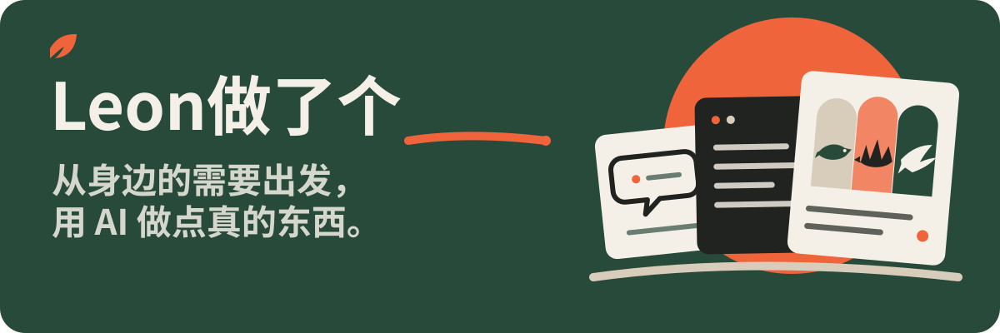
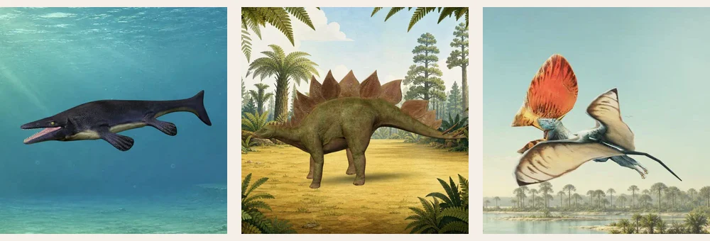
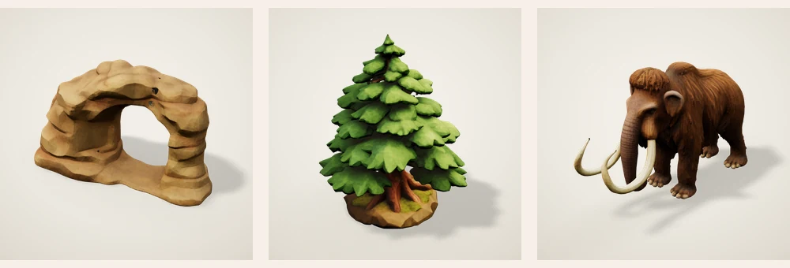

  

<h1 align="center">Hi, I’m Leon.</h1>

  <strong>Frontend developer &amp; dad building calm, useful products from real needs.</strong> 
  一个程序员爸爸，从身边的真实需要出发，用 AI 做点真的东西。

  <strong><a href="https://leon-made-this.work/museum/">打开博物馆 · Open the museum</a></strong>
  ·
  <strong><a href="https://s010s.github.io/lowpoly-vault/">浏览 3D 资产库 · Browse Lowpoly Vault</a></strong>

## 正在做 · Currently building

### [史前动物博物馆 · Prehistoric Animal Museum](https://github.com/s010s/prehistoric-animal-museum) 

女儿不喜欢以追逐和打斗为中心的恐龙内容，所以我做了一个可以安静观察的地方。孩子可以选择动物、转动模型、听一段简短介绍；大人可以坐在旁边，一起看，也可以顺着家长资料继续聊下去。

My daughter was uneasy with dinosaur stories built around chases and fights, so I made a quieter place to look closely. Children can choose an animal, turn the model, and listen to a short introduction while a grown-up explores beside them.

  

<a href="./assets/readme/SOURCES.md">Preview image credits</a>

[打开博物馆 · Open the museum](https://leon-made-this.work/museum/) · [查看源码 · View source](https://github.com/s010s/prehistoric-animal-museum) · [中文介绍](https://github.com/s010s/prehistoric-animal-museum/blob/main/README.zh-CN.md)

`18 animals` · `English / 简体中文` · `Mandarin + English narration` · `No account` · `No ads` · `No analytics scripts`

Built with React, TypeScript, Three.js, Vite, Vitest, and Playwright. The museum is free to visit, open source, responsive across phones and desktops, keyboard accessible, and respectful of reduced-motion preferences.

### [Lowpoly Vault](https://github.com/s010s/lowpoly-vault) 

一个持续扩充的开源低多边形 3D 资产库，目前以史前主题的动物、植物、地质与化石标本为主，已收录 1,000 个按米制尺度整理的模型。你可以在线旋转查看、开启线框或尺寸对比，并免费下载通用 GLB 模型和可编辑的 Blender 源文件。

An open, growing library of original stylized low-poly 3D assets, starting with 1,000 metric-scaled prehistoric animals, plants, landforms, and fossil specimens. Inspect models in the interactive web gallery with wireframe and hand-or-human size comparisons, then download both portable GLB files and editable Blender sources.

  

<a href="./assets/readme/SOURCES.md">Preview image credits</a>

[在线展厅 · Browse gallery](https://s010s.github.io/lowpoly-vault/) · [中文展厅](https://s010s.github.io/lowpoly-vault/zh-CN/) · [查看源码 · View source](https://github.com/s010s/lowpoly-vault) · [中文介绍](https://github.com/s010s/lowpoly-vault/blob/main/README.zh-CN.md)

`1,000 models` · `GLB + Blender` · `Metric scale` · `English / 简体中文` · `CC BY 4.0 + MIT`

Built with Blender, Three.js, Vite, Playwright, and glTF Validator. Original models and renders are licensed under CC BY 4.0, and the gallery and pipeline code is MIT licensed, with static bilingual model pages and one-click attribution.

## 小工具 · Small tools

### [Bob for OpenClip](https://github.com/s010s/openclip-bob)

从 PopClip 转到 OpenClip 后，我想保留一直在用的 Bob 划词翻译流程，于是做了这个小插件。选中文字，点一下按钮，就能在 Bob 中查看翻译，继续使用原有的翻译服务配置。

After moving from PopClip to OpenClip, I built a small extension to keep my familiar Bob translation workflow. Select text, click **Translate with Bob**, and read the result in Bob using your existing translation services.

[下载插件 · Download](https://github.com/s010s/openclip-bob/releases/latest) · [源码与使用说明 · Source & guide](https://github.com/s010s/openclip-bob)

`macOS` · `AppleScript` · `MIT`

## 我怎样做 · How I build

> **真实需要 → 人的判断 → AI 辅助实现 → 可用作品 → 真实反馈** 
> Real need → human judgment → AI-assisted making → something people can use → feedback.

AI expands what I can make. It does not replace the need, the product judgment, fact-checking, or final review.

## 近期合并的开源修复 · Recent merged contributions

- [**cmux #1496**](https://github.com/manaflow-ai/cmux/pull/1496) — fixed an `EXC_BAD_ACCESS` crash on Intel Macs caused by over-releasing a Ghostty font. 
  修复 Ghostty 字体被过度释放导致的 Intel Mac 崩溃。

- [**Kaku #213**](https://github.com/tw93/Kaku/pull/213) — stopped the AI Assistant from treating an expected SIGPIPE exit code `141` as a command failure. 
  避免把退出分页器等正常操作误报成命令失败。

- [**Kaku #318**](https://github.com/tw93/Kaku/pull/318) — cleared stale tab-drag state so selecting terminal text no longer reorders a previous tab. 
  清除残留的标签页拖拽状态，修复终端文本选择时的错误重排。

- [**KISS Translator #574**](https://github.com/fishjar/kiss-translator/pull/574) — added an opt-in setting to bypass translation services for single-word selections, reducing unnecessary latency and token use when enabled. 
  新增可选设置，启用后单词查询可以跳过翻译服务，减少等待和不必要的 Token 消耗。

## 早些时候 · Earlier work

[**vue-text-selection**](https://github.com/s010s/vue-text-selection) is a small Vue 2 directive for browser text selections—an early attempt to make an awkward browser interaction simpler.

这是我在 Vue 2 时期做的文本选择小工具，也是一次把复杂浏览器交互做得更简单的早期尝试。
